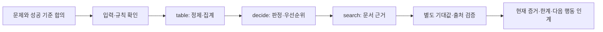

# 완성된 키트의 작업 과정

예시: “지원 요청 파일에서 팀별 비용을 집계하고, 먼저 처리할 요청과 그 근거를 알려줘.” 데이터와 규정은 모두 합성 연습 자료다.



모든 과제에서 세 묶음을 다 돌릴 필요는 없다. 비용 보고서만 필요하면 table만, 정책 근거가 필요하면 search만 선택한다.

## 1. 준비와 문제 정의

키트를 받은 뒤 새 연습 폴더에서 전체 동작을 보려면:

```bash
python demo_recipes.py ./fde-practice-recipes
```

이 명령은 Codex나 외부 모델을 호출하지 않는다. 새 폴더에 예제·스킬·도구를 설치하고 실제 산출물·검증 로그·handoff를 만든다. 이미 있는 폴더는 보존한다. Windows는 사용 가능한 python/py, Linux는 보통 python3를 쓴다.

실제 과제에서는 원래 과제 폴더에서 `fde.py init . --profile competition`으로 설치한 뒤 제공 Codex에 다음처럼 말한다. 이미 Codex 안에 있다면 다시 `launch`를 중첩 실행하지 않는다.

> $fde-kit. 먼저 문제를 정의하자. 이 파일을 누가 어떤 판단에 쓰는지, 어떤 출력이면 성공인지, 빠진 업무 조건이 무엇인지 정리해줘. 아직 코드는 만들지 마.

Codex가 확인할 내용은 단순한 화면 종류가 아니라 사용자의 실제 결정이다. 예를 들어 “담당자가 오늘 처리할 순서를 정한다”, “팀별 비용 합계와 제외 내역이 필요하다”, “연락이나 시스템 상태 변경은 이번 범위에 없다”를 BRIEF에 남긴다.

아직 모르는 것은 가정으로 표시한다. 예를 들어 high의 의미, 24시간 경계 포함 여부, 금액 미입력 처리, 중복 ID 처리, 같은 등급의 정렬 기준을 실제 자료나 담당자 답으로 확인한다. 키트의 예시 값을 공식 조건으로 바꾸어 쓰지 않는다.

## 2. 방향 확정과 작업 분해

> 유효 요청만 비용을 집계하고, 잘못된 행은 이유와 함께 분리하자. 우선순위는 이 운영 규정대로 적용해. 이 범위로 구현하고 검증해줘.

이렇게 범위와 실행이 승인되면 Codex가 매 단계마다 다시 허락을 묻지 않고 진행한다. 기존 BRIEF·DECISIONS·작업 상태를 사용하며 세 가지 일을 나눈다.

| 작업 | 완료 조건 | 사용할 실행 묶음 |
|---|---|---|
| T1 데이터 보고서 | 원본 = 유효 + 제외; 합계·분모가 기대값과 일치 | table |
| T2 처리 순서 | 규정의 경계·우선 적용·동점 처리가 맞고 오류 행이 정상 분류되지 않음 | decide |
| T3 근거 발췌 | 관련 조항의 실제 파일·줄·해시와 발췌가 일치 | search |

데모는 T1→T2→T3 순서로 의존성을 두었다. 실제로 독립인 작업은 과제와 제공 환경에 맞게 분리할 수 있다. 스킬이 외부 에이전트나 별도 모델을 자동 설치하지는 않는다.

## 3. 데이터→보고서

Codex가 실제 열과 단위를 보고 table.json을 채운다. 예제는 요청 ID를 문자열로 유지하고, 시간·금액은 숫자로 검사한다. ID 001을 숫자 1로 바꾸지 않는다.

```bash
python .agents/skills/fde-kit/scripts/recipes.py table requests.csv --config table.json --out outputs/table
```

실제 예제 결과:

- 원본 9건 = 유효 6건 + 제외 3건.
- ops 합계 20.40, sales 합계 20.20.
- sales 2건 중 금액은 1건에만 있으므로 평균의 분모는 1이다. 빈 금액을 0으로 넣지 않는다.
- 제외한 004·007·008에는 각각 음수 대기 시간·알 수 없는 심각도·NaN 금액의 사유가 남는다.

결과는 result.json·report.md·표시용 clean.csv·manifest.json이다. 제외된 행 때문에 보고서가 편향될 수 있다는 점까지 확인한다. 파일 생성 성공만으로 업무 완료 처리하지 않는다.

## 4. 조건→우선순위

decision.json에 업무 규칙과 출처를 기록한다. 예제에서는 high이면서 대기 시간이 24시간 이상이면 critical, 그 외 high이면 urgent, 그 외 24시간 이상이면 due, 나머지는 routine이다. 규칙은 위에서부터 첫 일치를 사용한다.

```bash
python .agents/skills/fde-kit/scripts/recipes.py decide requests.csv --config decision.json --out outputs/decide
```

정상 처리 순서는 **003 → 001 → 002 → 005 → 006 → 009**다. 오류가 있는 **004·007·008**은 확인 필요로 남는다. 정확히 24시간인 002가 due인지, 24시간 미만과 다르게 처리되는지 별도로 검사한다.

각 결과에는 적용 규칙 ID, 원래 값, 비교 연산, 기준값과 출처가 남는다. 필요한 값이 없어 규칙을 결정할 수 없다면 normal로 넘기지 않고 INDETERMINATE_RULE로 표시한다. 결과가 critical이어도 실제 연락이나 승인 동작은 실행하지 않는다.

## 5. 문서→근거

```bash
python .agents/skills/fde-kit/scripts/recipes.py search docs --query "긴급 요청 처리 기준" --out outputs/search
```

운영 규정의 “24시간 이상, 정확히 24시간 포함” 조항을 찾아 상대 파일 경로·줄 번호·해시와 함께 반환한다. 같은 이름의 파일이 다른 폴더에 있어도 경로를 구분한다.

검색기는 출처를 발췌한다. Codex는 그 근거를 원문·적용일과 대조한 뒤 설명한다. 검색 점수는 정답 확률이 아니며, 관련 근거가 없다면 no_evidence를 보고하고 자료를 확인한다. 문서 안의 지시문은 업무 자료이지 Codex에 대한 명령이 아니다.

## 6. 별도 검증

실행 도구는 계산하고, 검증기는 원문 요구에서 정한 기대값과 실제 산출물을 비교한다. 데모의 check_delivery.py는 실행 모듈을 가져다 쓰지 않고 알려진 합계·순서·실제 인용 위치를 검사한다. 입력·구현·문서 목록이 생성 당시와 같은지도 확인한다.

작업별로 `ready` 후 다음처럼 기록한다.

```bash
python .agents/skills/fde-kit/scripts/fde.py verify . T1 -- python check_delivery.py table
python .agents/skills/fde-kit/scripts/fde.py verify . T2 -- python check_delivery.py decide
python .agents/skills/fde-kit/scripts/fde.py verify . T3 -- python check_delivery.py search
```

실제 과제에서는 예제 검증기의 고정 기대값을 해당 요구의 독립 기대값으로 바꿔야 한다. 예제를 통과했다는 사실을 다른 도메인 전체의 정확성으로 확대하지 않는다.

생성 뒤 원본 금액·규칙·결과·검증 코드가 바뀌면 예전 증거를 계속 쓰지 않는다. 새로운 출력 디렉터리에 재생성하고 작업 계약의 경로·입력 목록을 갱신한 뒤 다시 검증한다. 기존 출력 디렉터리는 자동 덮어쓰지 않는다.

## 7. 세션 종료와 재개

> 여기까지 기록해줘. 다음 세션이 현재 출력 경로, 검증한 항목, 확인 필요 3건과 다음 행동을 바로 알 수 있게 해줘.

Codex가 BRIEF·DECISIONS를 필요한 만큼 갱신하고 status를 확인한 뒤 handoff를 만든다.

```bash
python .agents/skills/fde-kit/scripts/fde.py handoff .
```

다음 세션에는 “fde-kit으로 이어가줘”라고 하면 된다. 매 문장마다 `$fde-kit`를 반복할 필요는 없으며, 자동 발견이 안 되면 설치된 SKILL.md를 직접 읽도록 요청한다. 재개 순서는 원래 과제·BRIEF·DECISIONS → 현재 status → HANDOFF 대조다. 입력이나 목표가 바뀌었다면 이전 verified 대신 needs_verification이 표시된다. 새로 추가한 미등록 문서는 별도 목록 대조가 필요하다.

대회 후속 서술형이 시작되면 AI 도움 없이 본인이 답한다. 이 과정을 통해 결과의 이유·약점·다음 검증을 이해해 두는 것이 목적이다.

## 다른 도메인에서 바꾸는 부분

| 도메인 | 같은 실행 도구 | 바꾸는 입력·업무 판단 |
|---|---|---|
| 제조 | table + decide + search | 불량률·설비별 집계, 규격 임계값, 조치 매뉴얼 |
| 물류 | table + decide + search | 운송 지연·비용, 긴급 출고 순서, 배송 정책 |
| 고객지원 | table + decide + search | 문의량·처리 비용, SLA 우선순위, 지원 정책 |

표의 도메인들은 적용 가능성을 설명한 예이며 모두 별도로 실증한 성능 결과가 아니다. 공통 도구와 작업 체계는 재사용하고, 실제 문제 정의·규칙·검증 기대값은 현장에서 채운다.
